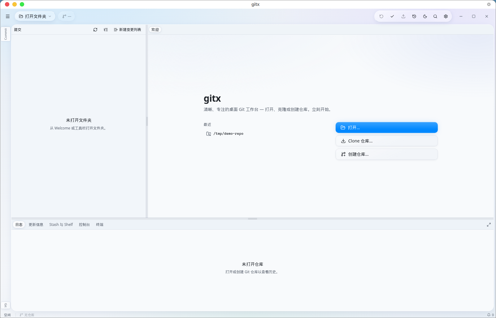

# gitx

English | [简体中文](./README.zh-CN.md)

A focused desktop Git workbench — open, clone, or create a repository and get to work.

Built with Tauri 2 + Vue 3 + Rust. Default UI language is English; 简体中文 is available in Settings → Appearance.

## Why gitx

- Clear main layout: Commit / Changes, Log, Diff, Stash in one window
- Light / dark / system / Liquid Glass themes, English + 简体中文
- Native desktop shell (Tauri) with a real Git engine, not a thin wrapper around a browser tab
- Inspired by IntelliJ IDEA’s Git tooling — aimed at day-to-day local workflow

## Download

Windows installers (NSIS `.exe` / MSI): **[latest Release](https://github.com/yifunxxx/gitx/releases/latest)**.

## User guide

**[Read the English guide](https://yifunxxx.github.io/gitx/en/)** · **[简体中文使用手册](https://yifunxxx.github.io/gitx/)**

Step-by-step guides cover installation, commits, file management and search, branches, synchronization, history, conflicts, Stash/Shelf, worktrees, settings, and shortcuts. The searchable VitePress site includes native desktop screenshots and a language switch on each page.

To contribute documentation, see [maintenance and GitHub Pages deployment](./docs/site/en/guide/publishing.md). Preview locally with `pnpm docs:dev`; validate and build with `pnpm docs:build`.

## Get started

Requires Node ≥ 22.13, pnpm 10, Rust (see `rust-toolchain.toml`), and system `git`.

```bash
pnpm install
pnpm tauri:dev
```

UI-only (mock backend, no Rust window): `pnpm dev:web`

## Screenshots

Liquid Glass · Light — Welcome:



Liquid Glass · Light — repository (Changes + Log):


Liquid Glass · Dark — Welcome:


## License

[MIT](./LICENSE)
