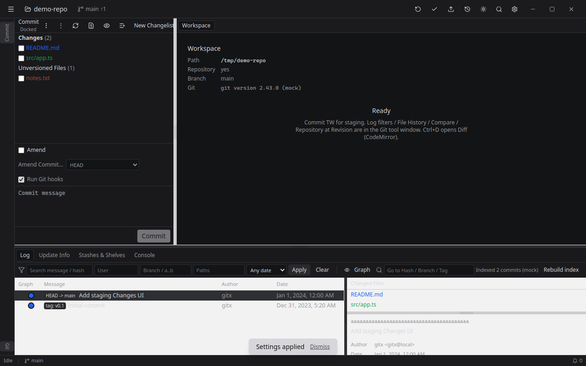
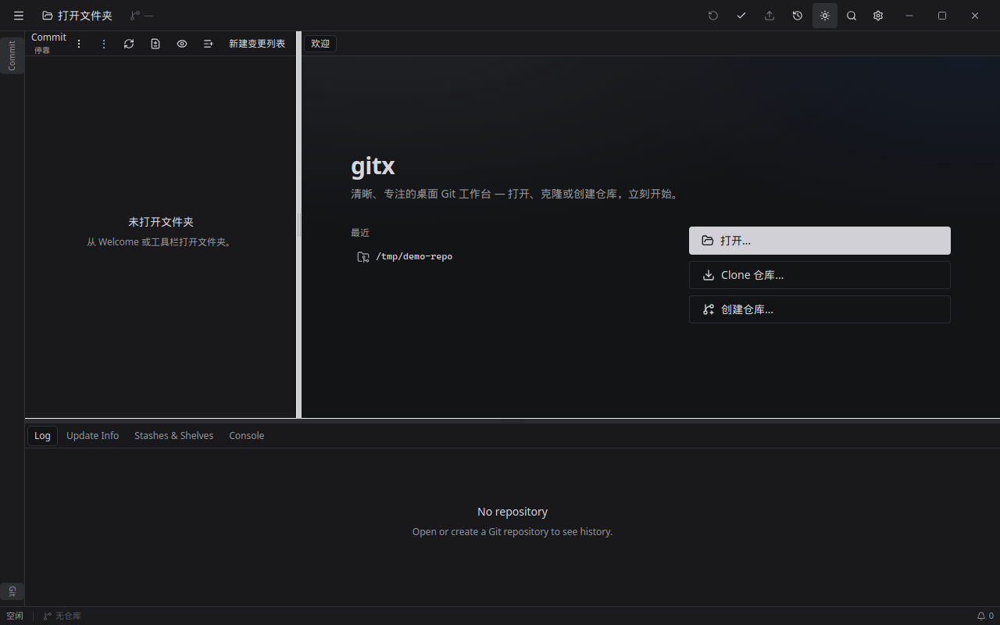

# gitx

English | [简体中文](./README.zh-CN.md)

A focused desktop Git workbench — open, clone, or create a repository and get to work.

Built with Tauri 2 + Vue 3 + Rust. Default UI language is English; 简体中文 is available in Settings → Appearance.

## Why gitx

- Clear main layout: Commit / Changes, Log, Diff, Stash in one window
- Light / dark / system themes, English + 简体中文
- Native desktop shell (Tauri) with a real Git engine, not a thin wrapper around a browser tab
- Inspired by IntelliJ IDEA’s Git tooling — aimed at day-to-day local workflow

## Get started

Requires Node ≥ 22.13, pnpm 10, Rust (see `rust-toolchain.toml`), and system `git`.

```bash
pnpm install
pnpm tauri:dev
```

UI-only (mock backend, no Rust window): `pnpm dev:web`

## Screenshots

Welcome:


Repository view (Changes + Log):



Welcome (dark):



## License

[MIT](./LICENSE)
