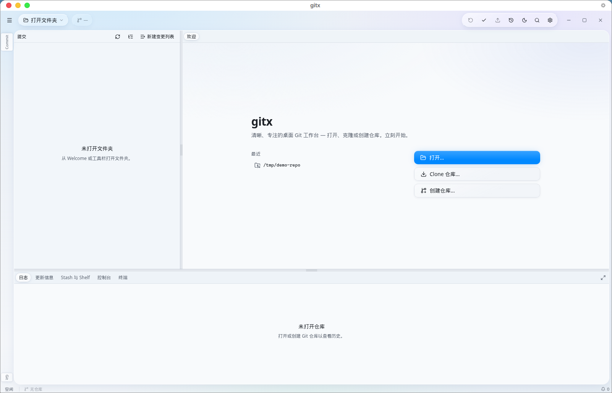
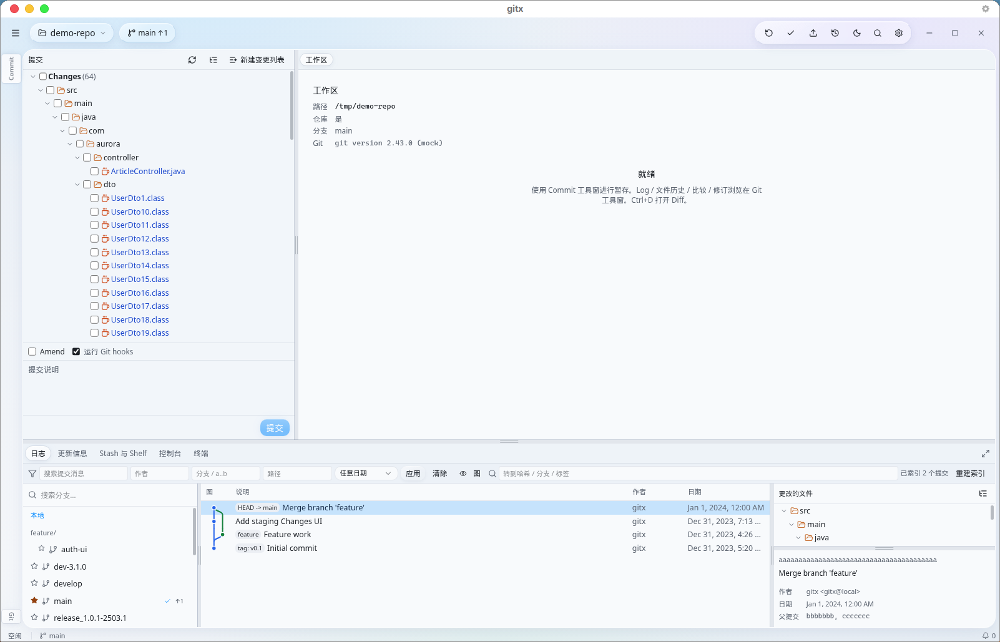
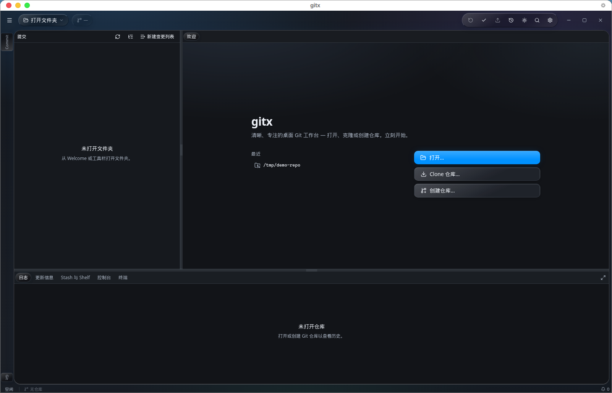

# gitx

[English](./README.md) | 简体中文

清晰、专注的桌面 Git 工作台 — 打开、克隆或创建仓库，立刻开始。

基于 Tauri 2 + Vue 3 + Rust。默认界面语言为 English；可在「设置 → 外观」切换简体中文。

## 优势

- 主界面清晰：Commit / Changes、Log、Diff、Stash 同窗可用
- 浅色 / 深色 / 跟随系统 / 液态玻璃主题，中英双语
- 原生桌面壳（Tauri）+ 真实 Git 引擎，不是浏览器页套壳
- 对标 IDEA 内置 Git 体验，面向日常本地工作流

## 如何启动

需要 Node ≥ 22.13、pnpm 10、Rust（见 `rust-toolchain.toml`）和系统 `git`。

```bash
pnpm install
pnpm tauri:dev
```

仅 UI（mock 后端，无 Rust 窗口）：`pnpm dev:web`

## 截图

液态玻璃 · 浅色 — Welcome：



液态玻璃 · 浅色 — 仓库主视图（Changes + Log）：



液态玻璃 · 深色 — Welcome：



## 开源协议

[MIT](./LICENSE)
