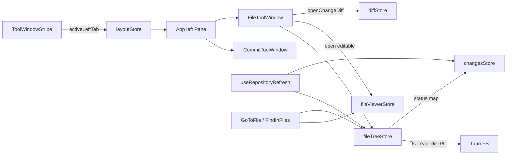
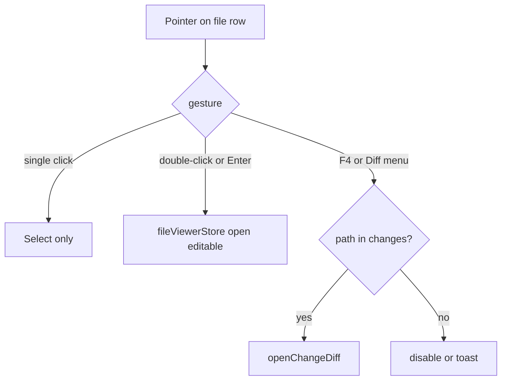
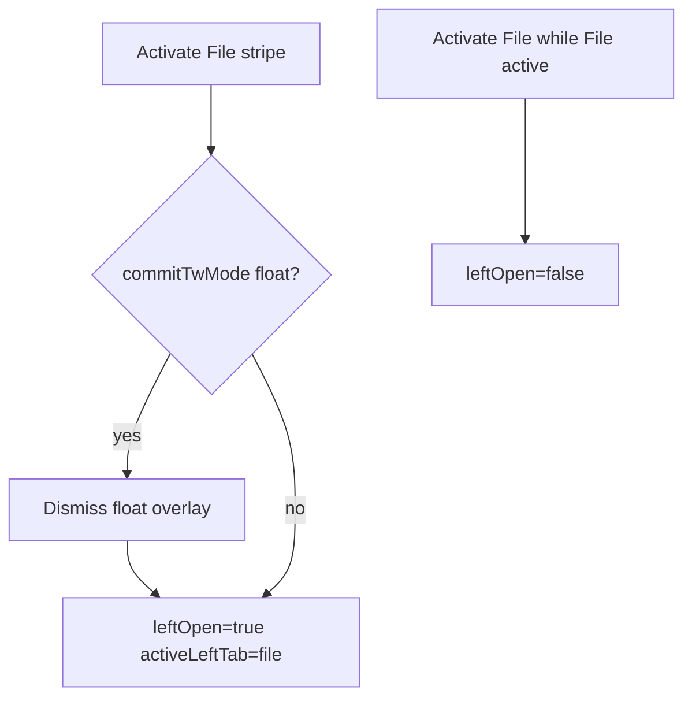

# feat: 左侧 File 工具窗（项目文件树）

## Goal Capsule

- **Objective:** 用户在左侧竖条能打开 File 工具窗，浏览当前工作区项目文件树（对标 IDEA Project / VS Code Explorer），打开可编辑文件、条件 Diff，并在后续分期获得树内拖拽与全局搜索能力，而无需离开 gitx。
- **Means:** 在 Commit 下方新增 File 竖条入口；左侧 dock 按 `activeLeftTab` 多路复用；懒加载工作区目录列举 + VirtualList + FileViewer/Diff/status 装饰；增强期交付树内 DnD 与全局搜索（KTD1–KTD8）。
- **Authority:** 本计划 Product Contract → Planning Contract → Implementation Units；仓库证据优先于对标推测；`docs/project-context.md` 的 deferred 列表优先于扩 scope；用户评审拍板覆盖先前假设。
- **Stop when:** MVP（U1–U6）满足 Definition of Done；增强分期（树内拖拽、全局搜索、CRUD 等）已登记为必做跟进，不标「以后再说」。
- **Out of scope here:** 写生产代码、开功能 PR；GitHub 插件等项目已 deferred 项（见 Scope Boundaries）。
- **Execution profile:** 代码实现；本文件为评审定稿后的实现权威。
- **Who finishes:** 实现代理完成单元与验证；用户已拍板 Open Questions。

## Product Contract

### Summary

在左侧工具栏 **Commit 竖条下方**（用户截图红框）增加 **File** 页签：项目文件树工具窗。默认英文界面、zh-CN 可选；视觉与交互延续 dbx / IDEA 工具窗体系。计划已含用户评审定案；**实现轮次另开，本文件仍禁止当作「已授权写生产代码」的许可**（实现由后续任务显式启动）。

### Problem Frame

gitx 已具备 Commit 左侧工具窗、EditorTabs、FileViewer、Changes 树与 Diff，但缺少「浏览整个工作区文件」的入口。用户只能从变更列表或其它路径间接打开文件，无法像 IDEA / VS Code 那样从项目树导航、搜索、管理文件。

### Actors

- A1. 日常提交者：在已打开的 Git 仓库中浏览文件、打开编辑、查看 Diff、配合 Commit。
- A2. 打开了文件夹但未启用 VCS 的用户：浏览文件夹并打开文件编辑（不强制先 Enable VCS）。
- A3. 大仓库用户：树必须懒加载与虚拟列表，否则复现已有 Changes 大列表卡顿（QA-034 / QA-008 类问题）。

### Requirements

- R1. 左侧竖条在 Commit **下方**提供 File 入口；点击后打开/聚焦左侧 File 工具窗内容。`(session-settled: user-directed — chosen over nesting inside Commit: 截图红框明确位置)`
- R2. File 工具窗展示当前工作区项目文件树（对标 IDEA Project / VS Code Explorer 的核心浏览体验）。
- R3. 树支持展开/折叠目录、选择节点；**单击仅选中；双击打开文件到可编辑 FileViewer**；Enter 与双击同为 Open File（非 Diff）。有 Git status 时可用 F4 / 菜单 Show Diff。`(session-settled: user-directed — click=select, double-click=open editable)`
- R4. 已知 Git 状态的文件可从菜单/快捷键打开 Diff（复用现有 Diff 管道）；干净文件 Diff 禁用或明确「与 HEAD 比较」（实现期二选一，默认禁用）。
- R5. 行装饰叠加 Git 状态（至少 M/A/D/U 等与 Changes 一致的视觉语言）。
- R6. 右键菜单至少覆盖：打开、Show Diff（条件）、Show History（条件）、Reveal in OS、Open in Terminal、Copy Path / Relative Path；目录行不提供文件编辑类动作。
- R7. **树内过滤（MVP）：** File 工具窗内按名称过滤已加载/可见树节点。  
  **全局搜索（必做，分期）：**  
  - R7a. **按文件名跳转（Go to File / Quick Open，对标 IDEA Navigate File、VS Code Quick Open）：** 工作区范围内按路径/文件名模糊匹配，选中后打开 FileViewer 并可选定位树节点。分期：**增强·优先（紧随 MVP）**；若排期允许可并入 MVP 末尾，但不阻塞 U1–U6 主路径。  
  - R7b. **按内容搜索（Find in Files，对标 IDEA Find in Files、VS Code Search）：** 工作区文本内容检索、结果列表、点击跳转打开并定位行。分期：**增强·后期**（依赖索引/扫描策略与性能护栏，在 R7a 之后）。
- R8. 可配置是否显示被 gitignore 的文件/隐藏文件；使用独立于 Changes `showIgnoredFiles` 的设置键，避免跨工具窗串扰。
- R9. CRUD（新建文件/文件夹、重命名、删除、复制、移动）进入**增强**分期；MVP 可只读浏览 + 打开，但须预留 IPC/菜单挂点。
- R10. **树内拖拽（必做，增强）：** 支持在项目树内拖拽移动（及合理的复制手势，如修饰键）文件/文件夹；落点校验、冲突提示、与 watcher 刷新一致。MVP **不做** FS 拖拽。拖到 changelist / 跨工具窗拖放亦属增强（可与树内 DnD 同分期或紧随）。**不再标「以后再说」。**`(session-settled: user-directed — DnD promoted out of later)`
- R11. 与 Commit 工具窗关系：File 与 Commit 为左侧 **同级** 工具窗（stripe 切换），不嵌套在 `CommitToolWindow` 内；共享 dock 宽度与 `leftOpen`。**Commit 浮层与 File 互斥：替换、不共存**——激活 File 时关闭/替换 Commit float 浮层并在 dock 显示 File；激活 Commit（含 float）时不与 File 内容并排浮层共存。`(session-settled: user-directed — replace, not coexist)`
- R12. 大仓库性能：禁止整仓同步 `buildPathTree`；懒加载目录 + VirtualList；折叠目录不物化子孙。
- R13. 空态：无文件夹 / 列举失败有明确 EmptyState/ErrorState + Retry。非 Git 文件夹：**允许浏览且允许打开编辑**（不为「非仓库」单独挡在 Enable VCS 墙后）。`(session-settled: user-directed — non-git folders openable)`
- R14. i18n：`toolWindows.file` 及 File 相关文案同时维护 en + zh-CN；默认 locale = en。
- R15. 设置：至少「显示忽略文件」「显示隐藏文件」；快捷键「Show File Tool Window」（建议 Alt+1，不抢 Alt+0 Commit）。
- R16. 分期交付：MVP → 增强·优先 → 增强·后期（见 KTD7）；项目级 deferred（GitHub 等）仍在 Scope Boundaries。
- R17. 计划评审与定稿阶段不写生产代码、不开功能 PR；实现须另有明确授权任务。`(session-settled: user-directed)`
- R18. **再次点击已激活的 File 竖条：关闭左侧 dock**，语义与 Commit 竖条一致。`(session-settled: user-directed — same as Commit stripe)`

### Key Flows

- F1. 打开 File 工具窗 → 懒加载根目录 → 展开子目录 → 双击打开可编辑 FileViewer（含非 Git 文件夹）。
- F2. 在有状态变更的文件上 Show Diff / F4 → Diff 标签页。
- F3. 右键 Reveal / Terminal / Copy path。
- F4. 工具窗内名称过滤缩小可见树；清除过滤后恢复策略明确。
- F5. 工作区 FS/ignore 变更经现有 watcher 刷新扩展目录与状态装饰，保持选中/滚动锚点。
- F6.（增强·优先）全局按文件名跳转 → 打开文件并可揭示树节点。
- F7.（增强·后期）按内容搜索 → 结果列表 → 打开并定位。
- F8.（增强）树内拖拽移动/复制 → 落点确认 → 树与 status 刷新。

### Acceptance Examples

- AE1. 打开含仓库的工作区后，点 File 竖条，根下列出顶层条目；展开某目录仅请求该目录。
- AE2. **双击**文本文件出现 FileViewer 标签且可编辑保存；**单击**仅选中不打开；Enter 打开同双击。
- AE2b. 打开**非 Git 文件夹**后，File 树可浏览；双击文件可打开并编辑保存（不强制 Enable VCS）。
- AE3. 对 Unstaged 修改文件右键 Show Diff 或 F4，打开与 Changes 一致的 Diff。
- AE4. 切换 Commit ↔ File，dock 宽度保持；内容正确切换；Commit message 等状态因 KeepAlive/`v-show` 不丢。
- AE4b. Commit 处于 float 时点 File → float 浮层被**替换/关闭**，左侧 dock 显示 File（二者不同时呈现）。
- AE5. 无文件夹时 File 显示 empty.noFolder；列举失败可 Retry。
- AE6. 竖条与工具窗标题在 en / zh-CN 下均正确。
- AE7. File 已激活时再点 File 竖条 → 关闭左侧 dock（与 Commit 一致）。
- AE8.（增强·优先）全局文件名跳转能匹配工作区内文件并打开。
- AE9.（增强）树内拖拽文件到另一目录后，树反映新位置且无静默失败。

### Success Criteria

- 用户能从左侧 File 树完成「找到文件 → 打开编辑 →（可选）看 Diff」主路径（含非 Git 文件夹）。
- MVP 在中等仓库（数千文件、深目录）下展开/滚动无明显主线程卡死。
- 与 Commit、EditorTabs、FileViewer、status 刷新共存无上下文菜单串扰；float 与 File 不并存。
- 增强分期完成后：树内 DnD 与全局文件名跳转可用；内容搜索按增强·后期交付。

### Scope Boundaries

#### In scope

- 左侧 File stripe + 左侧 dock 内容多路复用（含 float **替换**语义、再点关 dock）。
- 工作区目录懒列举 IPC、File 树 UI、状态装饰、打开 FileViewer（**含非仓库读写**）、条件 Diff、基础菜单、树内过滤、忽略/隐藏可见性、i18n/设置/快捷键。
- **增强必做：** CRUD；树内拖拽；全局文件名跳转；全局内容搜索（后期）；拖到 changelist（可与树内 DnD 同批或紧随）。

#### Deferred for later（产品/项目已 deferred——非本 File 功能清单）

- GitHub 插件体验（#125–136）、GitLab MR、Features Trainer、Modal Commit、Deployment after commit、语言相关提交检查（见 `docs/project-context.md`）。
- Submodule 克隆/注册（#11）。
- OS 级多窗口 File 面板、可拖动 stripe 到其它 anchor 的完整工具窗停靠拖拽体系。
- 完整「与 IDEA 一致的」多视图 Project View（Packages / Scratches 等）。

#### Deferred to Follow-Up Work（增强分期，**必做**，非永不做）

- CRUD 全套、**树内 DnD**、拖到 changelist、紧凑文件夹、多根完整 UX、文件夹聚合脏状态、**全局文件名跳转**、**全局内容搜索**（见 KTD7）。

#### Outside this product's identity

- 变成通用 IDE：调试器、语言服务、完整重构引擎等。
- 数据库/SQL 产品逻辑（dbx 领域能力不迁入）。

### Dependencies

- 现有：`layoutStore`、`ToolWindowStripe`、`CommitToolWindow`、`fileViewerStore` / `FileViewer`、`EditorTabs`、`changesStore` / status、`useRepositoryRefresh`、`VirtualList`、`FileTypeIcon`、`RepoAtRevisionView` 懒目录模式、`ContextMenuSurface`、i18n、settings schema。
- 新增：`fs_read_dir` / `workdir_list`（及 CRUD / rename-move）IPC——**不是**现有 `worktree_list` / `tree_list`；非仓库 `file_read`/`file_write`（或扩展现有 write）；`activeLeftTab`；File 工具窗组件与 store；增强期搜索索引/扫描与 DnD 落点 API。

### Outstanding Questions

#### Settled（用户评审 2026-11-25）

- Q1 → **Commit 浮层与 File：替换、不共存**（R11）。`(session-settled: user-directed)`
- Q2 → **非 Git 文件夹可以打开：浏览 + 打开编辑**（R13）。`(session-settled: user-directed)`
- Q3 → **再点 File 关侧栏，与 Commit 竖条逻辑一样**（R18）。`(session-settled: user-directed)`
- Q4 → **单击选中；双击打开可编辑文件；Enter = Open（同双击）；Diff 走 F4/菜单**（R3）。`(session-settled: user-directed)`

#### Deferred（实现期可决，不阻塞开工）

- 树内过滤时是否自动展开匹配祖先。
- 多选范围（Shift/Ctrl）粒度（增强多选时定）。
- 文件夹行是否显示聚合脏标记。
- 干净文件「Show Diff」禁用 vs 与 HEAD 比较。
- 全局内容搜索的索引策略（ripgrep 一次扫描 vs 增量索引）与默认排除集。

### Sources

- 用户请求 + 截图：`media/file-tab-sidebar-mark.png`
- 用户评审拍板（2026-11-25）：树内拖拽升档、全局搜索、Q1–Q4 定案
- `docs/project-context.md`（deferred 边界）
- `docs/dev-plan/01-framework.md`（工具窗体系、FileTree 组件名、虚拟化预算）
- 仓库现状：`ToolWindowStripe.vue`、`App.vue`、`layoutStore.ts`、`fileViewerStore.ts`、`ChangesTree.vue`、`PathTreeList.vue`、`RepoAtRevisionView.vue`、`useRepositoryRefresh.ts`

## Planning Contract

### Assumptions

1. 用户要的是 **左侧同级 File 工具窗**，不是把文件树塞进 Commit 面板。
2. 「对标 IDEA / VS Code」指核心浏览/打开/装饰/菜单/搜索/拖拽体验，不是 1:1 复制全部 Project View 视图。
3. MVP 以 **懒加载 FS 列举** 为主数据源，Git status 仅作装饰与条件 Diff，不把 ChangesTree 当项目树。
4. Q1–Q4 已 settled，实现按 R3/R11/R13/R18 执行，不再使用旧「默认假设 (a)/(c)」共存/挡 VCS 方案。
5. 不引入新 npm 依赖（内容搜索若用系统/侧车 ripgrep 须在实现单元论证）；沿用 VirtualList / ContextMenu / Pinia / Tauri 模式。
6. 忽略/隐藏可见性使用 **独立于 Changes** 的设置键。
7. MVP 不显示「已从磁盘删除但仍在 status 中」的幽灵节点。
8. 非仓库打开：扩展或并行于现有 `diffFile` 加载路径，使 `fileViewerStore` 在无 `repoId` 时仍能读/写工作区文件（实现细节留给 U4）。

### Key Technical Decisions

- KTD1. **左侧多路复用：** `layoutStore.activeLeftTab: 'commit' | 'file'`（持久化）；File 按钮在 Commit 下；左 Pane KeepAlive/`v-show`。`(session-settled: user-directed — File below Commit)`  
  **Float 替换：** 激活 File 时 `leftOpen=true`、`activeLeftTab=file`，并关闭 Commit float 浮层（必要时将 `commitTwMode` 切回 docked/window，或仅卸浮层——实现选最小改动但须满足「不共存」）。再点 File → `leftOpen=false`（同 Commit）。`(session-settled: user-directed — replace)`
- KTD2. **数据模型：懒加载工作区目录列举（`fs_read_dir` / `workdir_list`），禁止复用 `tree_list` / `worktree_list`。** 根 = `workspace.folderPath`。generation token 取消过期请求。  
  **未跑 Bake-off：** RepoAtRevision 懒目录成例已足够判决。
- KTD3. **不挂载 `ChangesTree`。** 新建 File 树；复用 VirtualList / FileTypeIcon；行键 = `kind + path`；status map 装饰。
- KTD4. **打开集成：** 双击/Enter → 可编辑 FileViewer（**仓库与非仓库**）；F4/菜单 → 条件 Diff；History 复用现有路径。`(session-settled: non-git openable)`
- KTD5. **刷新：** 挂接 `useRepositoryRefresh`；仅失效已展开目录；装饰更新不 churn 树身份（QA-034）。
- KTD6. **上下文菜单：** 独立 scope（如 `data-gitx-context="projectFiles"`）。
- KTD7. **分期（必做边界）：**

| 分期 | 内容 | 边界说明 |
| --- | --- | --- |
| **MVP** | Stripe + tab；float **替换**；再点关 dock；懒列举；单击选中/双击·Enter 打开；非 Git 可编辑打开；条件 Diff/History；基础右键；**树内名称过滤**；忽略/隐藏；空态；i18n；Show File 快捷键；status 装饰 | **不含**树内 DnD、全局搜索、CRUD |
| **增强·优先（紧随 MVP）** | **全局文件名跳转（R7a）**；CRUD IPC+UI；多选；**树内拖拽移动/复制（R10）**；拖到 changelist（可同批）；非仓库路径已在 MVP 打开则本阶段聚焦 CRUD/DnD/搜索 | DnD 与 R7a 为必做，不再「以后再说」 |
| **增强·后期** | **全局内容搜索（R7b）**；紧凑文件夹；文件夹聚合脏；复制路径/Reveal 多选增强；多根 UX 打磨 | 内容搜索在文件名跳转之后 |

- KTD8. **全局搜索范围：**  
  - 文件名跳转：工作区 `folderPath` 下路径/基名模糊匹配；尊重忽略/隐藏设置；结果打开 FileViewer。对标 IDEA *Navigate → File*、VS Code *Quick Open*（Ctrl/Cmd+P）——**不是**内容检索。  
  - 内容搜索：工作区文本 grep；结果含路径+行；打开定位。对标 IDEA *Find in Files*、VS Code *Search* 视图——**不是**仅树过滤。

### High-Level Technical Design

#### 组件关系

#### 打开与 Diff 决策

#### Float 替换

### Implementation Constraints

- 路径引用保持 repo-relative；计划内文件列表见各 U 单元。
- 禁止复活已废弃的 watcher 实验路径；挂接现有 watch。
- 不把 GitHub / Modal Commit 等 deferred 项带进本功能。
- MVP 仅 File 相关 i18n；Commit/Git 竖条 i18n 为非阻塞 follow-up。

### Execution Order

1. U1 布局多路复用（float 替换 + 再点关闭）  
2. U2 FS 列举 IPC  
3. U3 fileTreeStore + 懒树 UI  
4. U4 打开（含非仓库）/ Diff / 装饰  
5. U5 菜单 / 树内过滤 / 忽略隐藏 / 设置 / 快捷键 / i18n  
6. U6 刷新与性能护栏  

增强·优先：E1 CRUD → E2 树内 DnD（± changelist）→ E3 全局文件名跳转（E3 可与 E1 并行）。  
增强·后期：E4 全局内容搜索及其他打磨。

### Research Insights That Shape the Plan

- 左栏今日仅 Commit；无 `activeLeftTab`。
- 无工作区 FS 目录列举 IPC；`tree_list` / `worktree_list` 不可作项目树数据源。
- `fileViewerStore.open` 今日依赖 repo——MVP 须扩展以支持非 Git 打开。
- `buildPathTree` 全量同步在大仓库超帧；ChangesTree 不可复用为项目树。
- Commit float 与 dock 互斥既有张力——产品定案为 **替换**。

## Implementation Units

### U1. 左侧 File stripe 与 dock 多路复用

**Goal:** 用户可在 Commit 下切换到 File；float 替换；再点关 dock。  
**Requirements:** R1, R11, R14, R17, R18  
**Dependencies:** 无  
**Files:**
- `apps/desktop/src/stores/layoutStore.ts`
- `apps/desktop/src/components/layout/ToolWindowStripe.vue`
- `apps/desktop/src/App.vue`
- `apps/desktop/src/components/layout/FileToolWindow.vue`（新建，可先占位）
- `apps/desktop/src/components/layout/FileToolWindow.test.ts`（新建）
- `apps/desktop/src/features/commit/focusCommitUi.ts`
- `apps/desktop/src/i18n/locales/en.json`
- `apps/desktop/src/i18n/locales/zh-CN.json`

**Approach:**
1. `activeLeftTab` + 持久化；File 按钮置于 Commit 下。
2. 左 Pane 用 `v-show` / `<KeepAlive>` 保持双窗挂载。
3. 激活 File：**关闭 Commit float 浮层**（替换），`leftOpen=true`，显示 File。
4. File 已激活时再点 File → `leftOpen=false`（对齐 Commit）。
5. MVP i18n 仅 `toolWindows.file` 与 File 空态/错误文案。

**Patterns to follow:** `GitToolWindow` 的 `activeBottomTab`；`focusCommitUi` 测试。  
**Test scenarios:**
- 点击 File → `activeLeftTab=file` 且左 Pane 为 File。
- 点击 Commit → 切回 Commit。
- dock 关闭时点 File → 打开 dock 且为 File。
- float 模式下点 File → 浮层消失/替换，dock 显示 File（不与 float 并存）。
- File 激活时再点 File → dock 关闭。
- Commit 草稿在切 File 往返后仍在。
- `toolWindows.file` 存在于 en 与 zh-CN。

**Verification:** 单元测试通过；竖条在 Commit 下。

### U2. 工作区目录列举 IPC（`fs_read_dir` / `workdir_list`）

**Goal:** 前端可按目录懒拉取工作区子项。  
**Requirements:** R2, R12, R13  
**Dependencies:** 无（可与 U1 并行）  
**Files:**
- `src-tauri/src/commands/`（新建或扩；**勿**复用 `worktree_list` / `tree_list`）
- `src-tauri/src/lib.rs`
- `apps/desktop/src/lib/backend/bindings.ts`
- Rust 测试

**Approach:**
1. 输入：`folderPath`（有仓库时可对齐 `repoPath`）+ 相对目录；输出子项。
2. 拒绝逃逸出 workspace root。
3. 不做全仓递归；命名避开 `worktree_list` / `tree_list`。

**Patterns to follow:** `workspace_open_directory` 路径校验；`tree_list` 仅作 IPC 风格参考。  
**Test scenarios:**
- 列举临时目录返回文件与子目录。
- root 外路径失败。
- 空目录空列表；隐藏文件受 flag 控制。
- 非仓库 `folderPath` 可列举。

**Verification:** 相关 `cargo test` 通过。

### U3. fileTreeStore 与懒加载 File 树 UI

**Goal:** File 工具窗展示可展开的虚拟化项目树。  
**Requirements:** R2, R3, R12, R13  
**Dependencies:** U1, U2  
**Files:**
- `apps/desktop/src/stores/fileTreeStore.ts`（新建）
- `apps/desktop/src/stores/fileTreeStore.test.ts`（新建）
- `apps/desktop/src/features/file-tree/` 或 `features/project/`
- `apps/desktop/src/components/layout/FileToolWindow.vue`
- 复用 VirtualList、FileTypeIcon

**Approach:**
1. per-dir 缓存；expand 时 load；generation 丢弃过期响应。
2. VirtualList 展平行；行键含 kind。
3. 空态/错误态对齐 Commit。
4. 禁止整仓 `buildPathTree`。

**Patterns to follow:** `repoAtRevStore.loadDir`；ChangesTree VirtualList 参数。  
**Test scenarios:**
- 展开触发 list；缓存命中直至失效。
- 过期 generation 不覆盖新数据；同名文件/目录键不碰撞。
- 无 folderPath → empty；list 失败 → Error + Retry。
- 非仓库 folderPath 可懒列举。

**Verification:** vitest + typecheck。

### U4. 打开 FileViewer（含非仓库）、条件 Diff 与 Git 装饰

**Goal:** 单击选中；双击/Enter 打开可编辑文件（仓库与非仓库）；条件 Diff；装饰。  
**Requirements:** R3, R4, R5, R13  
**Dependencies:** U3  
**Files:**
- File 树组件与 `FileToolWindow.vue`
- `apps/desktop/src/stores/fileViewerStore.ts`（**扩展非仓库读/写**）
- 必要的 Tauri read/write 命令（若尚无独立于 diff 的读）
- `apps/desktop/src/features/commit/openChangeDiff.ts`、`statusColor.ts`
- 测试

**Approach:**
1. 单击 → 选中；双击/Enter → 可编辑 Open；目录 → toggle。与 ChangesTree 分叉：Changes 为 Enter→Diff、F4→Open；File 为 Enter/双击→Open、F4→Diff（有 status）。
2. 非仓库：不走「必须 repoId」早退；读/写工作区绝对或相对路径。
3. Show Diff / F4：仅 path 在 changes 映射中启用。
4. 装饰 join status map；无幽灵删除节点。

**Patterns to follow:** 现有 FileViewer 保存；`statusClass`。  
**Test scenarios:**
- 单击不打开；双击/Enter 打开且 `activeEditorKind=file`。
- 非仓库文件双击可编辑保存。
- 有 unstaged 时 F4 / Show Diff 正确；干净文件 Diff 禁用。
- 修改文件行带状态装饰。

**Verification:** 组件测试 + FileViewer 回归。

### U5. 右键菜单、树内过滤、忽略/隐藏、设置、快捷键、i18n

**Goal:** 完整 MVP 交互表层（树内过滤，**非**全局搜索）。  
**Requirements:** R6, R7（树内部分）, R8, R14, R15  
**Dependencies:** U3, U4  
**Files:**
- `FileToolWindow.vue` / 树组件
- `apps/desktop/src/actions/definitions/`
- `apps/desktop/src/features/settings/schema.ts`
- i18n；`changeLocation.ts` 复用

**Approach:**
1. 独立 context scope；目录/文件菜单分叉。
2. 过滤：对已加载可见行按名称匹配（全局文件名跳转见 E3）。
3. 独立 `showIgnoredInFileTree` / `showHiddenInFileTree`。
4. Alt+1；Find Action 可搜到 Show File。

**Test scenarios:**
- 右键文件含 Open / Copy；目录不含 Open File。
- 过滤隐藏不匹配行；隐藏文件开关生效。
- Show File 动作打开 File tab。

**Verification:** 菜单与 settings 测试绿。

### U6. Watcher 刷新、性能护栏与 Commit 关系打磨

**Goal:** 外部改文件后树与装饰正确更新。  
**Requirements:** R11, R12, F5  
**Dependencies:** U3, U4, U5  
**Files:**
- `apps/desktop/src/composables/useRepositoryRefresh.ts`
- `fileTreeStore.ts`
- 相关测试

**Approach:**
1. worktree/ignore → invalidate 已展开目录。
2. status 只更新装饰映射。
3. 保留选中与 scroll anchor。
4. 挂载策略已由 U1 固定。

**Test scenarios:**
- invalidate 后重 list；status-only 变时行身份稳定；锚点尽量保留。

**Verification:** 刷新单测 + 中等仓库手测。

### 增强·优先（必做跟进单元）

- E1. CRUD IPC（create/rename/delete/copy/move）+ 确认对话框。
- E2. **树内拖拽**移动/复制 + 落点校验 + 冲突提示；可选同批「拖到 changelist」。多选与批量菜单。
- E3. **全局文件名跳转（R7a）**：快捷键/命令面板；模糊匹配；打开 FileViewer；可选揭示树节点。

### 增强·后期（必做跟进单元）

- E4. **全局内容搜索（R7b）**：扫描/索引策略、结果 UI、打开定位行；尊重忽略规则与性能上限。
- E5. 紧凑文件夹、聚合脏标记、多根 UX 打磨等。

## Verification Contract

- 桌面：`pnpm --filter @gitx/desktop test`（及新增测试路径）。
- 类型：`pnpm typecheck`；Lint：`pnpm lint`；Rust：相关 `cargo test`。
- 手动冒烟：仓库 + **非 Git 文件夹** → File 浏览 → 双击编辑 → Diff → Commit↔File → float 时点 File 验证**替换** → 再点 File 关 dock。
- 增强验收：树内 DnD；文件名跳转；（后期）内容搜索。
- 回归：Changes 滚动/右键 scope、FileViewer、Commit Alt+0。

## Definition of Done

- MVP U1–U6 满足 R1–R8（树内过滤）、R11–R15、R18 与 AE1–AE7（含 AE2b/AE4b）。
- R9/R10/R7a/R7b 登记在增强分期且**不再**标「以后再说」；实现另开任务。
- Q1–Q4 已 settled 并写入 Requirements/KTD。
- 大仓库路径坚持懒加载+VirtualList。
- 本计划修订轮次仍无生产代码/功能 PR。

## Appendix

### 与现有能力对照

| 能力 | 现状 | File 计划 |
| --- | --- | --- |
| 左竖条 | 仅 Commit | Commit + File |
| 项目树 | 无 | 新建懒树 |
| 打开文件 | Changes F4 / 菜单 | 双击/Enter 为主；含非 Git |
| Diff | Changes 单击/Enter | F4/菜单 |
| FS list | 无（仅 git ls-tree） | 新 IPC |
| 装饰 | Changes 行内 | 叠加到项目树 |
| CRUD / 树内 DnD | 无 | 增强·优先必做 |
| 全局文件名跳转 | 无 | 增强·优先必做 |
| 全局内容搜索 | 无 | 增强·后期必做 |

### 评审定案摘要（2026-11-25）

1. 树内拖拽：升为**增强·优先必做**（MVP 不做）。  
2. 全局搜索：R7a 文件名跳转 = 增强·优先；R7b 内容搜索 = 增强·后期。  
3. Commit 浮层与 File：**替换、不共存**。  
4. 非 Git 文件夹：**可浏览 + 可打开编辑**。  
5. 再点 File：**关侧栏（同 Commit）**。  
6. 手势：**单击选中；双击/Enter 打开可编辑；Diff = F4/菜单**。

### Doc review

- 初稿 non-interactive 修正见前一修订；本轮为用户拍板后的产品定案更新。  
- 前次证据：`internal/file-tab-plan-doc-review.md`

### Confidence

- Depth: Standard  
- External research: 未跑（本地模式充足）  
- Confidence check: passed（拍板后决策闭合；实现期细节见 Deferred）  
- Bake-off: 未触发  
